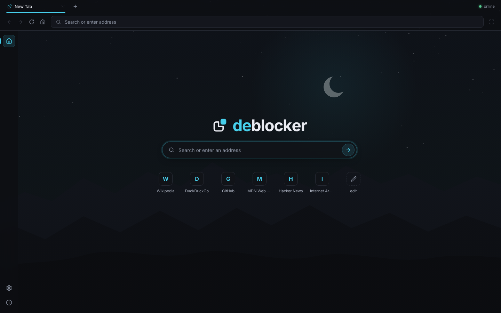
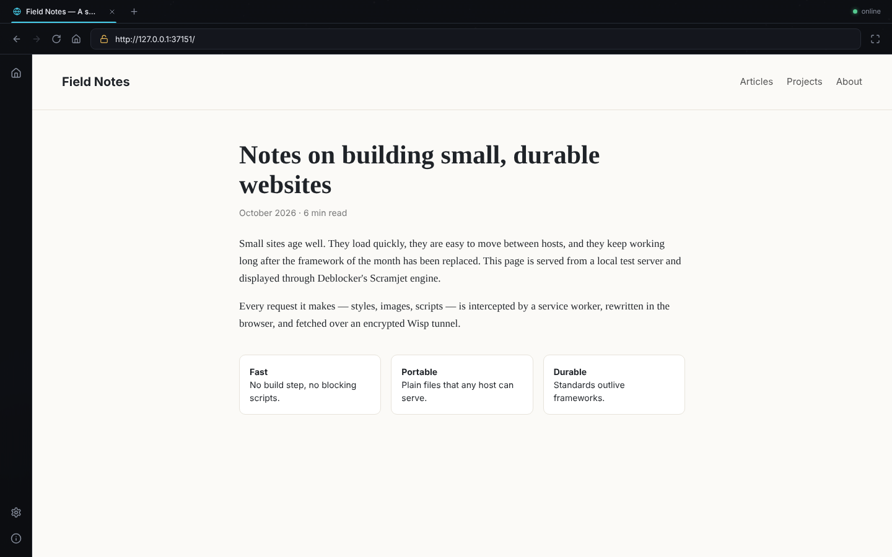
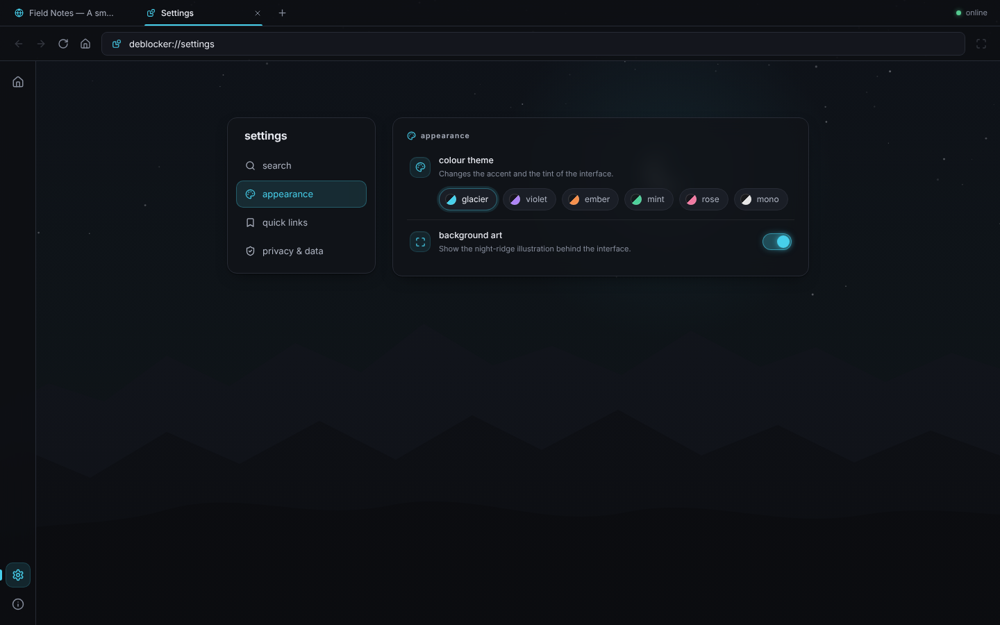
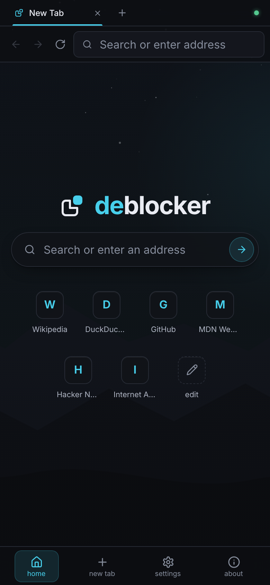

# Deblocker

A modern, self-hostable web proxy with a clean browser-style interface, powered by
[MercuryWorkshop's Scramjet](https://github.com/MercuryWorkshop/scramjet).



Deblocker gives you a familiar browser inside a web page: tabs, an address bar, back/forward/reload,
and a minimal home page with search and quick links. Pages you open are fetched and rewritten **inside your
own browser** by Scramjet and tunnelled to your Deblocker server over an encrypted
[Wisp](https://github.com/MercuryWorkshop/wisp-protocol) WebSocket. The server only relays bytes, and it
enforces a destination policy so it can't be used to reach your private network.

It is meant for legitimate browsing, testing and research on infrastructure you control.

| Browsing | Settings | Mobile |
|---|---|---|
|  |  |  |

---

## Contents

- [Features](#features)
- [How it works](#how-it-works)
- [Requirements](#requirements)
- [Quick start (local development)](#quick-start-local-development)
- [Production build](#production-build)
- [Configuration](#configuration)
- [Deployment](#deployment)
- [Security model](#security-model)
- [Testing](#testing)
- [Project structure](#project-structure)
- [Troubleshooting](#troubleshooting)
- [Known limitations](#known-limitations)
- [Updating or building Scramjet from source](#updating-or-building-scramjet-from-source)
- [License and credits](#license-and-credits)

## Features

- **Scramjet 2.x engine**, wired the way the official `create-proxy-app` template and Scramjet Controller
  intend: a service worker, a Controller with one Frame per tab, and the libcurl (default) or epoxy transport
  over Wisp.
- **Browser-style interface** inspired by Novene: tab strip, omnibox with a connection indicator,
  back/forward/reload/stop/home, an icon rail, and full-screen mode for pages.
- **Smart address bar.** Full URLs, bare domains (`example.com`, `localhost:3000`, IP addresses), searches
  (DuckDuckGo by default, configurable) and built-in pages (`deblocker://settings`). `javascript:`, `data:`,
  `file:` and other non-web schemes are refused.
- **Clear loading and error states.** A progress bar, a first-load overlay and a "taking a while" hint with
  a stop button. Errors are explained: unreachable site, TLS failure, blocked by policy, backend down. They
  come with useful actions (try again, try `http://`, search instead, go back).
- **Quick links** that visitors can add, edit, reorder and remove, plus operator defaults.
- **Settings**: search engine (presets or a custom `%s` template), six colour themes, background art
  on/off, quick-link editor, and a "clear site data" button. Settings stay in the visitor's browser.
- **Tabs survive a reload** of Deblocker itself. Links that open a new window, and proxied URLs opened
  directly, come back into the Deblocker interface.
- **Responsive.** Desktop, Chromebook, tablet, and phone (the rail becomes a bottom bar).
- **Keyboard shortcuts.** Enter, Ctrl/⌘+L, Alt+←/→, Alt+R, Alt+T, Alt+W, Alt+Home, Alt+1–9.
- **Responsible defaults.** No access to loopback/private/link-local networks, ports 80/443 only, no UDP,
  an optional host allowlist or blocklist, an optional access key, WebSocket origin checks, per-IP limits,
  and logs that don't record where visitors go.
- **Sub-path deployment** (`https://example.com/deblocker/`) works without rebuilding.

## How it works

```
 ┌─────────────────────── your browser ───────────────────────┐          ┌──── Deblocker server ────┐
 │ Deblocker UI ──► <iframe> per tab (proxied page)            │          │                           │
 │                     │ every request                          │          │  Express: UI, /api/*,     │
 │                     ▼                                        │          │  /engine/* (Scramjet,     │
 │   service worker (sw.js + Scramjet Controller)              │          │  controller, transport)   │
 │                     │ forwards to the page that owns the tab │          │                           │
 │                     ▼                                        │  Wisp    │  /wisp/  wisp-js server   │
 │   Scramjet Controller ── rewrites HTML/CSS/JS ── transport ─┼─────────►│   ├ origin / access-key   │
 │   (in the Deblocker page)       (libcurl / epoxy: TLS here) │ WebSocket│   ├ destination policy    │──► website
 └─────────────────────────────────────────────────────────────┘          │   └ TCP connection        │
                                                                          └───────────────────────────┘
```

1. `sw.js` (scoped to the base path) intercepts requests from proxied pages under `<base>~/sj/…`.
2. Scramjet Controller, running in the Deblocker page, rewrites URLs, HTML, CSS and JavaScript so everything
   stays inside the proxy. It also manages cookies.
3. The transport (libcurl.js or epoxy, both WebAssembly) performs TLS **in the browser** and multiplexes
   connections over one Wisp WebSocket to `<base>wisp/`.
4. The server checks each requested destination against its policy and opens the TCP connection.

The server never sees decrypted HTTPS traffic. It sees which host and port each stream goes to.

## Requirements

- **Node.js 20.11 or newer** (22 LTS recommended) and npm.
- **A secure context in the browser.** Service workers only run on `https://` or on `http://localhost`.
  For anything other than local testing, serve Deblocker over HTTPS.
- **WebSocket support** end to end (reverse proxies, CDNs and load balancers must allow upgrades).
- A modern Chromium-based browser, Firefox or Safari. Development and automated tests use Chromium.

## Quick start (local development)

```bash
git clone <your fork or this repository> deblocker
cd deblocker
npm install
npm run dev
```

Open <http://localhost:8080>. `npm run dev` runs the server with [tsx](https://github.com/privatenumber/tsx)
in watch mode, and serves the frontend through Vite with hot reload.

To test against sites on your own machine or LAN during development, allow private destinations
**for that session only**:

```bash
ALLOW_PRIVATE_DESTINATIONS=true ALLOWED_PORTS='*' npm run dev
```

## Production build

```bash
npm ci                 # install exact versions from package-lock.json
npm run build          # vite build (frontend -> dist/public) + tsc (server -> dist/server)
npm start              # node dist/server/index.js
```

Use `npm run check` to type-check, run the unit and integration tests, and build in one step.

Settings are environment variables. Node doesn't load `.env` files automatically. Either export the
variables, or start with `node --env-file=.env dist/server/index.js`, or use your service manager's env file.

## Configuration

Every setting is optional. See [`.env.example`](.env.example) for a commented template.

| Variable | Default | Description |
|---|---|---|
| `PORT` | `8080` | Port to listen on. |
| `HOST` | `0.0.0.0` | Interface to bind. Use `127.0.0.1` behind a local reverse proxy. |
| `BASE_PATH` | `/` | Path Deblocker is served under, e.g. `/deblocker`. See [sub-path deployment](#sub-path-deployment). |
| `TRUST_PROXY` | `false` | Trust `X-Forwarded-*` from a reverse proxy: `loopback`, a hop count (`1`), or proxy IPs/CIDRs. |
| `LOG_LEVEL` | `info` | `error`, `warn`, `info` or `debug`. Only `debug` logs destinations. |
| `TRANSPORT` | `libcurl` | Browser transport: `libcurl` or `epoxy`. |
| `ALLOWED_PORTS` | `80,443` | Destination ports or ranges (`80,443,8000-8100`), or `*`. |
| `ALLOW_PRIVATE_DESTINATIONS` | `false` | Allow loopback/private/link-local destinations. **Development only.** |
| `DESTINATION_ALLOWLIST` | (empty) | Only these hosts and their subdomains may be reached. |
| `DESTINATION_BLOCKLIST` | (empty) | These hosts and their subdomains are always refused. |
| `MAX_CONNECTIONS_PER_IP` | `24` | Concurrent Wisp WebSockets per client IP. |
| `MAX_STREAMS_PER_CONNECTION` | `128` | Concurrent streams per Wisp connection. |
| `ACCESS_KEY` | (unset) | If set (min. 8 chars), visitors must enter it once before the backend accepts them. |
| `SESSION_SECRET` | random | HMAC secret for access-key session cookies (min. 32 chars). Set it so sessions survive restarts. |
| `SESSION_TTL_HOURS` | `168` | Lifetime of an access-key session. |
| `ALLOWED_ORIGINS` | (empty) | Extra origins allowed to open the Wisp WebSocket (when a proxy rewrites `Host`). |
| `DEFAULT_SEARCH_ENGINE` | `duckduckgo` | `duckduckgo`, `google`, `bing`, `brave`, `startpage`, `wikipedia`, or a URL template with `%s`. |
| `DEFAULT_QUICK_LINKS` | built-in list | Comma-separated `Title\|https://url` pairs shown until a visitor customises them. |
| `SCRAMJET_DIST_DIR` | (unset) | Serve a locally built Scramjet core `dist/` instead of the npm package. |
| `SCRAMJET_CONTROLLER_DIST_DIR` | (unset) | Same for Scramjet Controller. |

Invalid values stop the server at start-up with a list of every problem, so misconfiguration is never
silent. The browser receives only public settings (`GET <base>api/config`); secrets never leave the server.

### HTTP endpoints

| Path (under `BASE_PATH`) | Purpose |
|---|---|
| `/` | The Deblocker interface. |
| `sw.js` | Service worker (must sit at the base path so its scope covers the app). |
| `engine/*` | Scramjet, Scramjet Controller and transport bundles from `node_modules` (ETag + Brotli/gzip). |
| `wisp/` | Wisp WebSocket endpoint (origin, access-key and per-IP checks). |
| `api/health` | Liveness check: `{ "status": "ok", "version": "…" }`. |
| `api/config` | Public configuration for the interface (no secrets). |
| `api/session` | Access-key session: `GET` state, `POST {"key"}` to unlock (rate-limited), `DELETE` to sign out. |
| `api/policy?url=` | Whether the destination policy allows a URL. Used to explain failed loads. Hostname rules only, no DNS. |

There are no administrative endpoints. Configuration is changed only through the environment.

## Deployment

Deblocker needs a long-running Node.js process that accepts WebSocket upgrades. It works on any VPS or
container host (a DigitalOcean/Hetzner/Linode VPS, Fly.io, Railway, Render, a home server, …).

**It does not work on static hosting** (GitHub Pages, Netlify/Vercel static sites, S3). It also does not
work on serverless functions that cannot hold WebSocket connections open: the Wisp backend is required.

> **Datacenter IPs.** Many sites show CAPTCHAs, rate limits or "unusual traffic" pages to visitors coming from
> hosting providers' IP ranges. Deblocker doesn't try to get around those checks. Expect some sites to ask for
> verification or refuse service.

### Option A: VPS with systemd and a reverse proxy

```bash
# 1. Install Node.js 22 (e.g. from https://nodejs.org or your distribution) and create a service user
sudo useradd --system --home /opt/deblocker --shell /usr/sbin/nologin deblocker

# 2. Get the code and build it
sudo git clone <repository-url> /opt/deblocker
cd /opt/deblocker
sudo npm ci
sudo npm run build
sudo chown -R deblocker:deblocker /opt/deblocker

# 3. Configure (see .env.example). Bind to localhost and trust the local reverse proxy.
sudo tee /etc/deblocker.env >/dev/null <<'EOF'
HOST=127.0.0.1
PORT=8080
TRUST_PROXY=loopback
EOF

# 4. Run it as a service
sudo cp deploy/deblocker.service /etc/systemd/system/
sudo systemctl daemon-reload
sudo systemctl enable --now deblocker
curl http://127.0.0.1:8080/api/health
```

Then put **Caddy** or **nginx** in front for HTTPS.

**Caddy** obtains and renews certificates automatically and proxies WebSockets without extra configuration.
See [`deploy/Caddyfile`](deploy/Caddyfile):

```caddyfile
proxy.example.com {
	encode zstd gzip
	reverse_proxy 127.0.0.1:8080
}
```

**nginx.** See [`deploy/nginx.conf`](deploy/nginx.conf). The important parts are the WebSocket upgrade
headers, forwarding the original `Host` **with its port** (`$http_host`), and long timeouts:

```nginx
map $http_upgrade $connection_upgrade { default upgrade; '' close; }

location / {
    proxy_pass http://127.0.0.1:8080;
    proxy_http_version 1.1;
    proxy_set_header Upgrade $http_upgrade;
    proxy_set_header Connection $connection_upgrade;
    proxy_set_header Host $http_host;
    proxy_set_header X-Forwarded-For $proxy_add_x_forwarded_for;
    proxy_set_header X-Forwarded-Proto $scheme;
    proxy_read_timeout 1h;
    proxy_buffering off;
}
```

Get a certificate with `sudo certbot --nginx -d proxy.example.com` (or use the paths in the example file).

To update a deployment: `git pull && npm ci && npm run build && sudo systemctl restart deblocker`.
Visitors pick up the new service worker automatically on their next page load.

### Option B: Docker

```bash
docker build -t deblocker .
docker run -d --name deblocker --restart unless-stopped \
  -p 127.0.0.1:8080:8080 -e TRUST_PROXY=1 --env-file .env deblocker
```

Or use `docker compose up -d --build` with the included [`docker-compose.yml`](docker-compose.yml) (Compose
2.24 or newer for the optional `.env`). Put a TLS-terminating reverse proxy in front as above. The image
runs as the unprivileged `node` user and includes a health check against `api/health`.

### HTTPS

HTTPS is required for real deployments. Without it, browsers disable service workers and Deblocker can't
start: it shows "Deblocker must be opened over HTTPS". Terminate TLS at Caddy, nginx, a load balancer or a CDN.

If you use **Cloudflare** or another CDN, make sure WebSockets are enabled for the hostname. Some CDN and
corporate proxies close idle WebSockets; raise idle timeouts where you can.

### Sub-path deployment

To serve Deblocker at `https://example.com/deblocker/` next to other apps:

1. Set `BASE_PATH=/deblocker`. The server mounts everything (UI, `sw.js`, `engine/*`, `api/*`, `wisp/`) under it.
2. Configure the reverse proxy to forward that prefix **without stripping it**:
   - nginx: `location /deblocker/ { proxy_pass http://127.0.0.1:8080; … }` (no trailing slash or path on
     `proxy_pass`);
   - Caddy: `handle /deblocker* { reverse_proxy 127.0.0.1:8080 }` (`handle`, not `handle_path`).
3. No rebuild is needed. The frontend uses relative asset paths and derives the service-worker scope, the
   Scramjet prefix, the engine paths and the Wisp URL from the page's own location. `/deblocker` redirects to
   `/deblocker/`.

Sub-path deployment is covered by the automated test suite, and the nginx example was verified by running
Deblocker behind it (sub-path over HTTP and root over HTTPS).

### Transport and WebSocket notes

- The Wisp endpoint is `<BASE_PATH>wisp/` on the same origin as the interface. No separate port or service is needed.
- `TRANSPORT=libcurl` (default) uses [libcurl.js](https://github.com/ading2210/libcurl.js).
  `TRANSPORT=epoxy` uses [epoxy-tls](https://github.com/MercuryWorkshop/epoxy-tls). Both encrypt TLS in the
  browser. Try epoxy if a particular site misbehaves with libcurl.
- The server uses [`@mercuryworkshop/wisp-js`](https://github.com/MercuryWorkshop/wisp-js). If you outgrow it,
  you can run another Wisp server (e.g. wisp-server-python) behind the same path. You would then have to
  re-implement the destination policy there.

## Security model

Deblocker is designed so that running it publicly doesn't hand strangers an open door into your network:

- **Destination policy.** Every Wisp stream is checked before a socket is opened:
  - **Ports.** Only `ALLOWED_PORTS` (default 80 and 443).
  - **Hostnames.** Loopback, private, CGNAT, link-local (including cloud metadata such as
    `169.254.169.254`), multicast, reserved and documentation ranges are refused. So are IPv6 equivalents,
    IPv4-mapped/NAT64 addresses and names like `localhost`, `*.local` and `*.internal`.
  - **DNS rebinding.** Names are resolved by Deblocker, which refuses non-public results. The socket then
    connects to the exact address that was checked, which closes the gap between checking and connecting.
  - **Allowlist and blocklist.** Optional host lists match each host and its subdomains.
  - **UDP** is disabled.
- **Only your own site can use the WebSocket.** Upgrades must carry an `Origin` matching the request's
  `Host` (or `ALLOWED_ORIGINS`), so other websites can't use visitors' browsers to tunnel through your server.
- **Optional access key.** With `ACCESS_KEY` set, the Wisp endpoint requires a signed, HttpOnly,
  `SameSite=Strict` session cookie. Key checks use constant-time comparison and are rate-limited
  (10 attempts per 15 minutes per IP).
- **Limits.** Concurrent connections per IP and streams per connection are capped.
- **Privacy-preserving logs.** Destinations are only logged at `LOG_LEVEL=debug`.
- **No secrets in the browser.** The client receives only the public config. Error pages generated for
  failed loads are HTML-escaped and served with a script-blocking CSP.
- **Hardening headers.** `nosniff`, `no-referrer`, `frame-ancestors 'self'`, no `X-Powered-By`.

What Deblocker does **not** do: it doesn't bypass CAPTCHAs or bot detection, collect credentials, disguise
itself, or evade network filters. Proxied sites run in your browser at the Deblocker origin, so treat a
Deblocker deployment as you would any browser profile: sign-ins and cookies made through it live there until
you clear them in **Settings → privacy & data**.

## Testing

```bash
npm test              # unit + integration tests (config, URL handling, IP classification,
                      # policy, sessions, Wisp gateway, HTTP API, sub-path mounting)
npm run build && npm run test:e2e
                      # end-to-end tests in headless Chromium through the real Scramjet pipeline
```

The end-to-end suite starts the built server and a small local website. It drives Deblocker in Chromium
and checks: navigation from the home page and the omnibox, links, back/forward, redirects,
`history.pushState`, `fetch()`, form POST bodies, search, the https→http fallback, error pages, refused
schemes, tabs, new-window links, recovery after the browser stops the idle service worker, settings and tab
persistence across reloads, quick-link editing, the blocked-destination messages (client-side and
server-side), sub-path deployment and the access-key flow.

It needs a Chromium/Chrome binary: set `CHROMIUM_PATH=/path/to/chrome` if it isn't found automatically.
Playwright's browsers work too. If no browser is found, the browser suites are skipped.

## Project structure

```
src/
  server/             Node server (TypeScript, compiled to dist/server)
    index.ts          entry point: HTTP server, upgrades, graceful shutdown
    app.ts            Express app: API, engine assets, frontend, sub-path mounting
    config.ts         environment parsing and validation
    wisp.ts           Wisp gateway (origin/access/limits) and wisp-js policy wiring
    policy.ts         destination policy (ports, private ranges, allow/blocklists)
    access.ts         optional access key: signed session cookies, rate limiting
    engine.ts         locating and serving Scramjet/controller/transport bundles
    http-utils.ts     client IPs behind proxies, origin checks, upgrade rejection
  shared/             code used by both server and browser
    url.ts            address/search detection and normalisation
    net.ts            IP address classification
    public-config.ts  types and search engine presets
  client/             frontend (Vite root)
    index.html        app shell, icons, background art
    public/sw.js      service worker (Scramjet Controller + revival/redirect handling)
    src/engine/       Scramjet integration (controller, frames, hooks, error pages)
    src/app/          tabs, navigation, history, loading and error states
    src/ui/           home, settings, about, toasts
    src/styles/       design tokens and component styles
tests/
  unit/ integration/ e2e/
deploy/               nginx, Caddy and systemd examples
```

## Troubleshooting

| Symptom | Cause and fix |
|---|---|
| "Deblocker must be opened over HTTPS" | Service workers need a secure context. Use HTTPS, or `http://localhost` for local testing. |
| Status shows **backend unreachable** / "Can't reach the Deblocker server" | The Wisp WebSocket at `<base>wisp/` can't be opened. Check that the reverse proxy forwards `Upgrade`/`Connection` headers (see `deploy/nginx.conf`) and that the CDN or firewall allows WebSockets. Look for 403/401/429 in the server log. |
| Server log: `wisp: rejected connection … with origin …` (HTTP 403) | The WebSocket `Origin` doesn't match the `Host` header Deblocker sees. Forward the original host **including the port** (`proxy_set_header Host $http_host;`), or list the public origin in `ALLOWED_ORIGINS`. |
| 401 on `wisp/` | `ACCESS_KEY` is set and the browser has no valid session. Enter the key on the home page. If you didn't set `SESSION_SECRET`, sessions reset whenever the server restarts. |
| 429 on `wisp/` | `MAX_CONNECTIONS_PER_IP` reached. Many users behind one NAT? Raise the limit, and set `TRUST_PROXY` correctly so real client IPs are used. |
| Every site shows "Blocked by this server" | The address is private or local, uses a port outside `ALLOWED_PORTS`, or `DESTINATION_ALLOWLIST`/`BLOCKLIST` refuses it. With an allowlist, remember that sites load assets from other domains (CDNs) that must be allowed too. |
| Pages load without styles or images | Usually a site serving assets from a host or port your policy refuses. Run with `LOG_LEVEL=debug` to see refused destinations. |
| 404s for `/engine/*.js`, or "Couldn't load …/engine/scramjet.js" | Dependencies are missing (`npm ci`), or the reverse proxy doesn't forward the full path. Check `BASE_PATH` matches the public path. |
| Blank frame or "session has ended" after redeploying | Reload Deblocker. The page re-registers with the new service worker. If the problem persists, unregister the service worker in DevTools → Application. |
| "This browser doesn't allow service workers here" | Some private-browsing modes and enterprise policies disable service workers, so Deblocker can't run. Use a normal window or another browser profile. |
| A plain `http://` site served directly by Node.js hangs | libcurl asks plain-HTTP servers for an `h2c` upgrade, which some servers mishandle. Use `TRANSPORT=epoxy` or the site's `https://` address. |
| CAPTCHAs or "unusual traffic" pages | The destination dislikes your server's IP (common for datacenter IPs). Deblocker doesn't bypass these checks. |
| `Port 8080 is already in use` | Set `PORT` to a free port. |

## Known limitations

- **Not every site works through a proxy.** Expect trouble with strict bot protection, DRM video, WebRTC
  calls, and sign-in flows that check the network you connect from.
- Popup-based sign-in flows that rely on `window.opener` lose it. New windows open as separate Deblocker
  windows.
- Scramjet 2.x is published as an **alpha** (`2.0.67-alpha.2`). Deblocker pins exact versions, and works
  around three upstream issues:
  - the start-up/update service-worker revival races;
  - a `pushState` URL bug that is fixed on Scramjet's main branch;
  - `HttpCachePlugin` dropping `Set-Cookie` from the responses it caches.
- Keyboard shortcuts work while the Deblocker interface or a proxied page has focus. Browser-reserved
  shortcuts (Ctrl+T/W/Tab) can't be overridden.
- Deblocker relies on service workers, WebAssembly and modern CSS. Very old browsers aren't supported.

## Updating or building Scramjet from source

Deblocker uses the **official prebuilt release artifacts** published to npm: `@mercuryworkshop/scramjet`,
`@mercuryworkshop/scramjet-controller` and `@mercuryworkshop/scramjet-utils`. These are produced by
Scramjet's own release workflow (`RELEASE=1 pnpm rewriter:build && pnpm build`, run by the packages'
`prepack` scripts), so no Rust toolchain is needed to install Deblocker.

**To update**, bump the pinned versions in `package.json`, run `npm install`, then `npm run build` and
`npm run test:e2e`. The Scramjet packages are versioned together, so update them together.

**To build Scramjet yourself** (for example, to test an unreleased fix), follow the upstream instructions:

```bash
# requirements: node, pnpm, rustup, wasm-bindgen, binaryen's wasm-opt, r58Playz's wasm-snip fork
git clone --recursive https://github.com/MercuryWorkshop/scramjet
cd scramjet && pnpm i
cd packages/core && pnpm rewriter:build && pnpm build
cd ../controller && pnpm build
```

Then point Deblocker at the output:

```bash
SCRAMJET_DIST_DIR=/path/to/scramjet/packages/core/dist \
SCRAMJET_CONTROLLER_DIST_DIR=/path/to/scramjet/packages/controller/dist \
npm start
```

## License and credits

Deblocker's own code is released under the [MIT License](LICENSE).

It builds on:

| Project | License |
|---|---|
| [Scramjet](https://github.com/MercuryWorkshop/scramjet), Scramjet Controller and scramjet-utils | AGPL-3.0 |
| [libcurl-transport](https://github.com/MercuryWorkshop/CurlTransport) / [libcurl.js](https://github.com/ading2210/libcurl.js) | AGPL-3.0 |
| [epoxy-transport](https://github.com/MercuryWorkshop/epoxy-transport) | AGPL-3.0 |
| [wisp-js](https://github.com/MercuryWorkshop/wisp-js) | LGPL-3.0 |
| [Express](https://expressjs.com) | MIT |
| [Inter](https://rsms.me/inter/) (self-hosted via Fontsource) | OFL-1.1 |
| [Lucide](https://lucide.dev) icon shapes | ISC |

The Scramjet engine files are served to visitors unmodified from npm. The AGPL requires that users who
interact with them over a network can get their source code. The in-app **About** page links to each
project's source. If you modify those components, publish your changes.

The interface's visual language is inspired by the Novene proxy front end. Deblocker's code, branding,
icons and background art are original.
